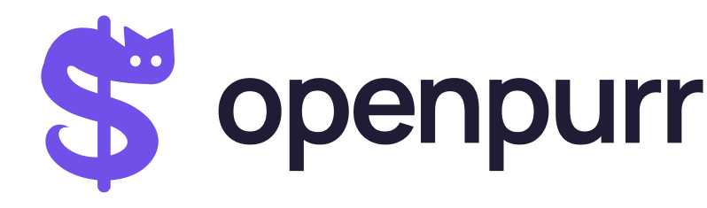
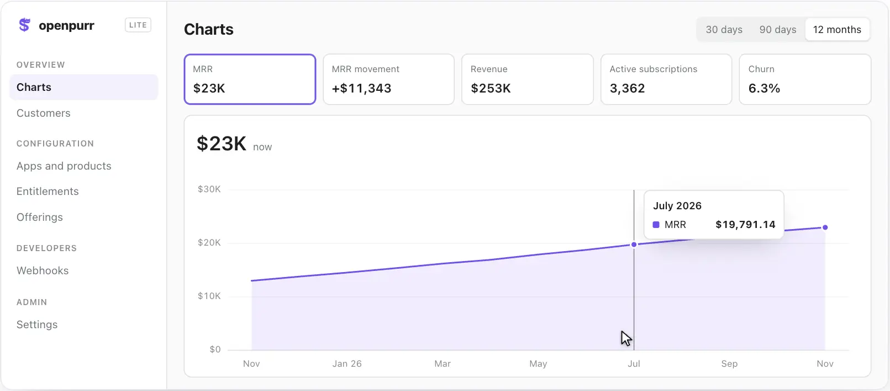

<!-- translated-from: README.md sha256:576cb367384b5532 -->
<h1 align="center">
  <picture>
    <source media="(prefers-color-scheme: dark)" srcset=".github/assets/openpurr-logo-dark.png">
    
  </picture>
</h1>

<!-- languages -->
<p align="center"><a href="README.md">English</a> · <a href="README.de.md">Deutsch</a> · <a href="README.es.md">Español</a> · <b>Français</b> · <a href="README.it.md">Italiano</a> · <a href="README.nl.md">Nederlands</a> · <a href="README.pl.md">Polski</a> · <a href="README.pt-BR.md">Português (Brasil)</a> · <a href="README.tr.md">Türkçe</a> · <a href="README.id.md">Bahasa Indonesia</a> · <a href="README.vi.md">Tiếng Việt</a> · <a href="README.ar.md">العربية</a> · <a href="README.hi.md">हिन्दी</a> · <a href="README.ja.md">日本語</a> · <a href="README.ko.md">한국어</a> · <a href="README.zh-CN.md">简体中文</a> · <a href="README.zh-TW.md">繁體中文</a></p>
<!-- /languages -->

Un backend open source et auto-hébergé, alternative à RevenueCat.

Avec les SDK Purchases open source de RevenueCat, faites pointer le `Purchases.proxyURL` de votre application vers votre propre serveur. openpurr valide les achats App Store et Google Play, suit les entitlements, reçoit les notifications des stores, envoie des webhooks à votre backend et trace vos principaux indicateurs d'abonnement. Il tourne sur une infrastructure que vous contrôlez.

openpurr est un projet indépendant, sans lien avec RevenueCat, Inc. et non soutenu par cette société.

<picture>
  <source media="(prefers-color-scheme: dark)" srcset=".github/assets/openpurr-dashboard-demo-dark.webp">
  
</picture>

## Pour qui

Les développeurs d'applications qui :

- **Veulent garder la main sur leur infrastructure d'achats.** Vos enregistrements d'achat, vos entitlements et les identifiants de vos stores sont sur des serveurs que vous gérez, dans une base de données que vous pouvez interroger, sauvegarder et exporter. Aucun service externe ne s'interpose entre votre application et vos clients.
- **Ne veulent pas reverser un pourcentage de leurs revenus.** openpurr ne prend aucune part des revenus et ne facture aucuns frais par transaction. L'édition Lite est conçue pour tenir dans l'offre gratuite de Cloudflare : une petite application peut la faire tourner sans rien payer.
- **Ne veulent pas dépendre d'un service commercial.** Le code est open source : vous pouvez le lire, le modifier et le déplacer entre Cloudflare et votre propre cloud.

openpurr convient aussi si vous utilisez déjà les SDK de RevenueCat et voulez les garder. Il fonctionne avec les SDK officiels, sans modification : pour migrer, vous commencez par changer une URL, pas par réécrire votre code d'achat. Pour transférer vos clients existants, consultez [Migrer depuis RevenueCat](https://openpurr.org/fr/migrate-from-revenuecat/).

**Ce n'est peut-être pas (encore) pour vous** si vous avez besoin d'un éditeur de paywalls, d'intégrations analytiques tierces ou d'un contrat de support. Les plateformes commerciales les proposent dès aujourd'hui. Consultez la [feuille de route](ROADMAP.md) (en anglais) pour savoir ce qui arrive.

## Ce qu'il fait

- **Achats :** valide les transactions StoreKit 2 et les achats Google Play, et renvoie le `CustomerInfo` et les entitlements attendus par le SDK.
- **Notifications des stores :** reçoit les App Store Server Notifications V2 et les Real-time Developer Notifications de Google Play.
- **Webhooks :** envoie à votre backend des événements au format RevenueCat, signés en HMAC-SHA256 et renvoyés pendant environ 72 heures.
- **Graphiques :** 16 graphiques dans le tableau de bord, filtrables par projet, app, store, produit et environnement, et exportables en CSV :
  - **Revenus :** revenus, remboursements, taux de remboursement et achats hors abonnement.
  - **Revenus récurrents :** MRR, ARR et évolution du MRR.
  - **Abonnements :** abonnements actifs, abonnements payants, évolution des abonnements, statut des abonnements et churn.
  - **Essais :** essais en cours, nouveaux essais et évolution des essais.
  - **Clients :** nouveaux clients.
- **Authentification :** clés SDK et clés secrètes, connexion des opérateurs (mot de passe avec codes d'authentification facultatifs ; Cloudflare Access est prévu), rôles et journal d'audit.
- **Serveur MCP et skills Claude :** un assistant IA peut rechercher des clients, expliquer pourquoi quelqu'un a ou n'a pas un entitlement, et vous guider dans la configuration de l'App Store et de la Play Console.

**Hors périmètre pour l'instant :** paywalls, événements publicitaires, Customer Center, monnaies virtuelles, paiement web, Amazon et intégrations analytiques tierces. Les tests de prix sont intégrés : voir le [guide](docs/price-experiments.md) (en anglais).

## Deux éditions

| | Lite | Standard |
|---|---|---|
| Langage | TypeScript | Go |
| Tourne sur | Cloudflare Workers + D1 | Conteneurs + Postgres sur GCP, AWS ou DigitalOcean |
| Coût | Conçu pour tenir dans l'offre gratuite de Cloudflare | Votre facture cloud |
| Pour | Apps indépendantes : légère et peu coûteuse à faire tourner | Portefeuilles d'applications plus importants |

Les deux éditions passent la même suite de tests de conformité, dans `spec/`. Vous pouvez passer de Lite à Standard sans publier de mise à jour de l'application, à condition que celle-ci pointe vers un domaine personnalisé qui vous appartient : voir [Passer de Lite à Standard](docs/migrating-from-lite-to-standard.md) (en anglais).

## Ce que vous gardez par rapport à RevenueCat

L'offre Pro de RevenueCat est gratuite sous 2 500 $ de revenus suivis par mois, puis facture 1 % de la totalité. Lite tourne sur l'offre gratuite de Cloudflare, puis sur Workers Paid, à partir de 5 $ par mois, quand votre app la dépasse.

<a href="https://openpurr.org/fr/#savings">
  <picture>
    <source media="(prefers-color-scheme: dark)" srcset=".github/assets/openpurr-savings-dark.webp">
    
  </picture>
</a>

| Revenus mensuels | RevenueCat, par mois | openpurr Lite, par mois | Économie par an |
|---|--:|--:|--:|
| 2 000 $US | 0 $US | 0 $US | **0 $US** |
| 5 000 $US | 50 $US | 0 $US | **600 $US** |
| 10 000 $US | 100 $US | 0 $US | **1 200 $US** |
| 25 000 $US | 250 $US | 5 $US | **2 940 $US** |
| 50 000 $US | 500 $US | 5 $US | **5 939 $US** |
| 100 000 $US | 1 000 $US | 9 $US | **11 896 $US** |
| 250 000 $US | 2 500 $US | 20 $US | **29 764 $US** |

Estimations, tarifs vérifiés le 21 novembre 2026. Elles supposent environ 1,50 $ de revenus mensuels et 10 requêtes SDK par jour par utilisateur actif quotidien, ce qui place le passage à Workers Paid vers 11 250 $US par mois. [Essayez vos propres chiffres](https://openpurr.org/fr/#savings).

## Compatibilité des SDK

Dès le premier jour, openpurr utilise les SDK officiels, sans modification (tous sous licence MIT) :

| SDK | Comment le faire pointer vers openpurr |
|---|---|
| iOS | `Purchases.proxyURL = URL(string: "https://purchases.example.com")` |
| Android | `Purchases.proxyURL = URL("https://purchases.example.com")` |
| Flutter, React Native | `Purchases.setProxyURL("https://purchases.example.com")` |

Définissez l'URL de proxy avant d'appeler `configure`. Laissez la vérification des entitlements à sa valeur par défaut (désactivée), car les réponses signées reposent sur la clé propre à RevenueCat.

**Limite connue sur Android :** le SDK envoie le trafic de diagnostic, de paywalls et de publicités directement à trois hôtes de RevenueCat, même quand une URL de proxy est définie. openpurr désactive les diagnostics via la configuration distante. N'utilisez pas les paywalls ou les publicités de RevenueCatUI sur Android avec openpurr.

## Organisation prévue du dépôt

```
spec/       language-neutral contract: OpenAPI, JSON schemas, fixtures, conformance suite
lite/       Lite edition: lightweight, for indie apps on Cloudflare Workers (TypeScript)
standard/   Standard edition: for larger app portfolios on GCP, AWS or DigitalOcean (Go)
cli/        `npx @openpurr/cli` (works with either edition)
skills/     Claude Code plugin
examples/   sample apps
infra/      Terraform/OpenTofu modules for GCP, AWS and DigitalOcean
```

## Premiers pas

openpurr en est à la version 0.4.0 : attendez-vous à des changements avant la 1.0. Pour l'essayer sur votre propre compte Cloudflare (l'offre gratuite suffit), avec Node 22.12 ou une version ultérieure :

```sh
git clone https://github.com/openpurr/openpurr && cd openpurr
npx pnpm install
cd lite && npx wrangler login
npx pnpm run setup      # database, both Workers, operator secret and your owner account
```

Vous pouvez relancer l'installation sans risque si elle s'arrête en cours de route. Elle se termine par un lien vers le tableau de bord, qui s'ouvre sur l'ajout de votre première application : son bundle ID et son nom de package, puis les produits, les entitlements et les offres. Un même déploiement peut faire tourner plusieurs applications sous forme de projets distincts, chacun avec ses propres clients. Ensuite :

- **Vérifiez votre configuration :** lancez `npx @openpurr/cli login`, puis `npx @openpurr/cli doctor`. La commande indique ce qui manque et comment corriger chaque point.
- **Recevez des alertes d'utilisation :** ajoutez un jeton d'API Cloudflare avec la permission Account Analytics: Read comme secret `CLOUDFLARE_ANALYTICS_TOKEN`, et le tableau de bord vous prévient avant que les limites quotidiennes de l'offre gratuite ne bloquent les requêtes.
- **Sauvegardez vos données :** `npx pnpm db:backup` exporte la base de données dans un fichier. D1 conserve aussi 7 jours d'historique avec l'offre gratuite (30 avec Workers Paid).
- **Déployez à chaque push :** forkez le dépôt et ajoutez vos informations Cloudflare comme secrets du dépôt. [`lite-deploy.yml`](.github/workflows/lite-deploy.yml) en donne la liste.

Vous utilisez Claude Code ? Le [plugin openpurr](plugin/) (en anglais) vous guide dans les mêmes étapes, ainsi que dans la configuration d'App Store Connect et de la Play Console.

Pour Standard, suivez le guide de votre cloud : [GCP](docs/standard-on-gcp.md), [AWS](docs/standard-on-aws.md) ou [DigitalOcean](docs/standard-on-digitalocean.md) (en anglais). Chacun déploie avec un modèle OpenTofu tiré de `infra/`.

## Contribuer

Consultez [CONTRIBUTING.md](CONTRIBUTING.md) (en anglais). En ce moment, l'aide la plus utile, ce sont vos retours dans les issues : hypothèses erronées sur les SDK ou les stores, et cas limites rencontrés en conditions réelles.

Pour toute autre question, écrivez à [hello@openpurr.org](mailto:hello@openpurr.org).

## Historique des étoiles

<a href="https://www.star-history.com/?repos=openpurr%2Fopenpurr&type=timeline&legend=bottom-right">
 <picture>
   <source media="(prefers-color-scheme: dark)" srcset="https://api.star-history.com/chart?repos=openpurr/openpurr&type=date&theme=dark&legend=bottom-right" />
   <source media="(prefers-color-scheme: light)" srcset="https://api.star-history.com/chart?repos=openpurr/openpurr&type=date&legend=bottom-right" />
   
 </picture>
</a>

## Licence

[Licence Apache 2.0](LICENSE). Copyright 2026 contributeurs d'openpurr.
