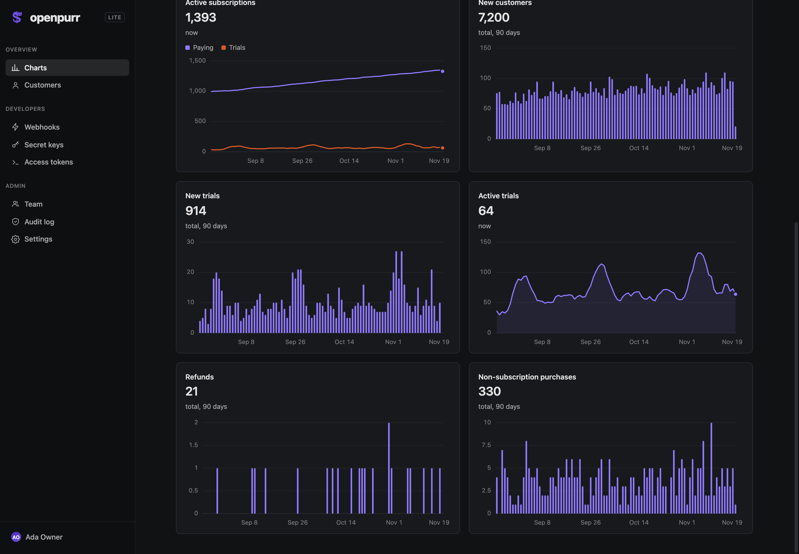

<h1 align="center">
  <picture>
    <source media="(prefers-color-scheme: dark)" srcset=".github/assets/openpurr-logo-dark.png">
    
  </picture>
</h1>

An open-source, self-hosted backend for the RevenueCat SDKs.

Point your app's `Purchases.proxyURL` at your own server and keep using the SDK you already have. openpurr validates App Store and Google Play purchases, tracks entitlements, receives store notifications, sends webhooks to your backend, and charts your core subscription metrics. It runs on infrastructure you control.

openpurr is an independent project. It is not affiliated with or endorsed by RevenueCat, Inc.



## Who it's for

App developers who:

- **Want to control their own purchase infrastructure.** Your purchase records, entitlements and store credentials live on servers you run, in a database you can query, back up and export. No outside service sits between your app and your customers.
- **Don't want to share a percentage of their revenue.** openpurr has no revenue share and no per-transaction fees. The Lite edition is designed to fit Cloudflare's free plan, so a small app can run it for nothing.
- **Don't want to depend on a commercial service.** It's open source: you can read the code, change it, and move it between Cloudflare and your own cloud.

It's also a good fit if you already use the RevenueCat SDKs and want to keep them. openpurr works with the official, unmodified SDKs, so switching starts with changing one URL, not rewriting your purchase code.

**It may not be for you (yet)** if you need paywall builders, A/B experiments, third-party analytics integrations or a support contract. Commercial platforms offer those today. See the [roadmap](ROADMAP.md) for what's coming.

## What it does

- **Purchases:** validates StoreKit 2 transactions and Google Play purchases, and returns the `CustomerInfo` and entitlements the SDK expects.
- **Store notifications:** receives App Store Server Notifications V2 and Google Play Real-time Developer Notifications.
- **Webhooks:** sends RevenueCat-shaped events to your backend, signed with HMAC-SHA256 and retried for about 72 hours.
- **Charts:** a small dashboard with active subscriptions, MRR, trials, conversions and churn.
- **Auth:** SDK keys and secret keys, operator login (password with optional authenticator codes, or Cloudflare Access), roles, and an audit log.
- **MCP server and Claude skills:** an AI assistant can look up customers, explain why someone does or doesn't have an entitlement, and walk you through App Store and Play Console setup.

**Out of scope for now:** paywalls, ad events, Customer Center, virtual currencies, web billing, Amazon, experiments, and third-party analytics integrations.

## Two editions

| | Lite | Standard |
|---|---|---|
| Language | TypeScript | Go |
| Runs on | Cloudflare Workers + D1 | Containers + Postgres on GCP or AWS |
| Cost | Designed to fit the Cloudflare free plan | Your cloud bill |
| For | Indie apps: lightweight and cheap to run | Larger portfolios of apps (coming soon) |

Both editions pass the same conformance suite in `spec/`. You can move from Lite to Standard without shipping an app update, as long as your app points at a custom domain you own.

## SDK compatibility

Day one uses the official, unmodified SDKs (all MIT licensed):

| SDK | How to point it at openpurr |
|---|---|
| iOS | `Purchases.proxyURL = URL(string: "https://purchases.example.com")` |
| Android | `Purchases.proxyURL = URL("https://purchases.example.com")` |
| Flutter, React Native | `Purchases.setProxyURL("https://purchases.example.com")` |

Set the proxy URL before calling `configure`. Leave entitlement verification at its default (disabled), because signed responses rely on RevenueCat's own key.

**Known gap on Android:** the SDK sends diagnostics, paywall and ad traffic to three RevenueCat hosts directly, even when a proxy URL is set. openpurr turns diagnostics off through remote config. Don't use RevenueCatUI paywalls or ads on Android with openpurr.

## Planned repo layout

```
spec/       language-neutral contract: OpenAPI, JSON schemas, fixtures, conformance suite
lite/       Lite edition: lightweight, for indie apps on Cloudflare Workers (TypeScript)
standard/   Standard edition: for larger app portfolios on AWS or GCP (Go, coming soon)
cli/        `npx openpurr` (works with either edition)
skills/     Claude Code plugin
examples/   sample apps
infra/      Terraform/OpenTofu modules for GCP, AWS and DigitalOcean
```

## Getting started

Nothing to install yet. Once the Lite edition ships, setup will look like this:

```sh
npx openpurr init      # writes config and wrangler.toml, creates D1, KV and secrets
npx wrangler deploy
npx openpurr doctor    # checks store credentials, notification URLs and keys
```

## Contributing

See [CONTRIBUTING.md](CONTRIBUTING.md). Right now the most useful help is feedback in issues: wrong assumptions about the SDKs or the stores, and real-world edge cases.

## License

[Apache License 2.0](LICENSE). Copyright 2026 openpurr contributors.
