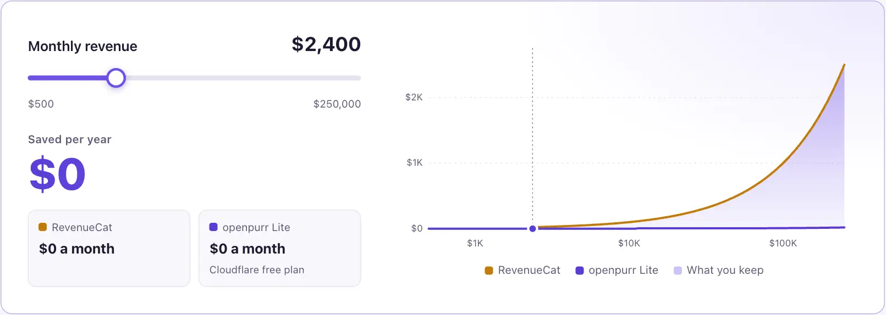

<!-- translated-from: README.md sha256:51ff71c4d2f67d7f -->
<h1 align="center">
  <picture>
    <source media="(prefers-color-scheme: dark)" srcset=".github/assets/openpurr-logo-dark.png">
    
  </picture>
</h1>

<!-- languages -->
<p align="center"><a href="README.md">English</a> · <a href="README.de.md">Deutsch</a> · <a href="README.es.md">Español</a> · <a href="README.fr.md">Français</a> · <a href="README.it.md">Italiano</a> · <a href="README.nl.md">Nederlands</a> · <a href="README.pl.md">Polski</a> · <a href="README.pt-BR.md">Português (Brasil)</a> · <a href="README.tr.md">Türkçe</a> · <a href="README.id.md">Bahasa Indonesia</a> · <a href="README.vi.md">Tiếng Việt</a> · <a href="README.ar.md">العربية</a> · <a href="README.hi.md">हिन्दी</a> · <a href="README.ja.md">日本語</a> · <a href="README.ko.md">한국어</a> · <b>简体中文</b> · <a href="README.zh-TW.md">繁體中文</a></p>
<!-- /languages -->

一个自托管、开源的 RevenueCat 替代方案后端。

继续使用 RevenueCat 开源的 Purchases SDK，把 App 的 `Purchases.proxyURL` 指向你自己的服务器。openpurr 验证 App Store 和 Google Play 的购买，跟踪权益，接收商店通知，向你的后端发送 Webhook，并以图表展示核心订阅指标。它运行在你掌控的基础设施上。

openpurr 是一个独立项目，与 RevenueCat, Inc. 没有任何关联，也未获得其认可。

<picture>
  <source media="(prefers-color-scheme: dark)" srcset=".github/assets/openpurr-dashboard-demo-dark.webp">
  
</picture>

## 适合谁

适合这样的 App 开发者：

- **想自己掌控购买基础设施。** 你的购买记录、权益和商店凭据存放在你自己运行的服务器上，保存在你可以查询、备份和导出的数据库中。你的 App 和客户之间没有任何外部服务。
- **不想分出一部分收入。** openpurr 没有收入分成，也没有按交易收取的费用。Lite 版专为 Cloudflare 免费套餐设计，小型 App 可以零成本运行。
- **不想依赖商业服务。** 它是开源的：你可以阅读代码、修改代码，并在 Cloudflare 和你自己的云之间迁移。

如果你已经在使用 RevenueCat SDK 并希望继续使用，它也很合适。openpurr 兼容官方、未经修改的 SDK，因此切换只需从改一个 URL 开始，无需重写购买代码。要把现有客户迁移过来，请参阅[从 RevenueCat 迁移](https://openpurr.org/zh-cn/migrate-from-revenuecat/)。

如果你需要付费墙构建器、第三方分析集成或支持合同，**它（目前）可能还不适合你**。目前商业平台已经能提供这些。即将推出的功能请参阅[路线图](ROADMAP.md)（英文）。

## 功能

- **购买：** 验证 StoreKit 2 交易和 Google Play 购买，并返回 SDK 所需的 `CustomerInfo` 和权益。
- **商店通知：** 接收 App Store Server Notifications V2 和 Google Play Real-time Developer Notifications。
- **Webhook：** 向你的后端发送与 RevenueCat 格式相同的事件，使用 HMAC-SHA256 签名，失败时会在约 72 小时内重试。
- **图表：** 仪表盘提供 16 张图表，可按项目、应用、商店、商品和环境筛选，并可导出为 CSV：
  - **收入：** 收入、退款、退款率和非订阅购买。
  - **经常性收入：** MRR、ARR 和 MRR 变动。
  - **订阅：** 活跃订阅、付费订阅、订阅变动、订阅状态和流失。
  - **试用：** 活跃试用、新增试用和试用变动。
  - **客户：** 新客户。
- **认证：** SDK 密钥和秘密密钥、管理员登录（密码，可选验证器动态码；Cloudflare Access 已在计划中）、角色，以及审计日志。
- **MCP 服务器和 Claude Skills：** AI 助手可以查询客户，解释某人为什么拥有或没有某项权益，并引导你完成 App Store 和 Play Console 的配置。

**暂不支持：** 付费墙、广告事件、Customer Center、虚拟货币、Web 计费、Amazon 和第三方分析集成。价格实验已内置，参见[指南](docs/price-experiments.md)（英文）。

## 两个版本

| | Lite | Standard |
|---|---|---|
| 语言 | TypeScript | Go |
| 运行环境 | Cloudflare Workers + D1 | GCP 或 AWS 上的容器 + Postgres |
| 成本 | 专为 Cloudflare 免费套餐设计 | 你的云账单 |
| 适用于 | 独立 App：轻量，运行成本低 | 拥有更多 App 的团队（即将推出） |

两个版本都通过 `spec/` 中的同一套一致性测试。只要你的 App 指向你自己拥有的自定义域名，从 Lite 迁移到 Standard 就无需发布 App 更新。

## 与 RevenueCat 相比，你能留下多少

RevenueCat 的 Pro 方案在每月跟踪收入低于 2,500 美元时免费，超过后按全部收入的 1% 收费。Lite 运行在 Cloudflare 免费套餐上；当应用超出免费额度后，可使用每月 5 美元起的 Workers Paid。

<a href="https://openpurr.org/zh-cn/#savings">
  <picture>
    <source media="(prefers-color-scheme: dark)" srcset=".github/assets/openpurr-savings-dark.webp">
    
  </picture>
</a>

| 月收入 | RevenueCat（每月） | openpurr Lite（每月） | 每年节省 |
|---|--:|--:|--:|
| US$2,000 | US$0 | US$0 | **US$0** |
| US$5,000 | US$50 | US$0 | **US$600** |
| US$10,000 | US$100 | US$0 | **US$1,200** |
| US$25,000 | US$250 | US$5 | **US$2,940** |
| US$50,000 | US$500 | US$5 | **US$5,939** |
| US$100,000 | US$1,000 | US$9 | **US$11,896** |
| US$250,000 | US$2,500 | US$20 | **US$29,764** |

以上为估算，价格核对于 2026年11月21日。假设每位日活跃用户每月带来约 1.50 美元收入、每天 10 个 SDK 请求，因此约在月收入 US$11,250 时改用 Workers Paid。 [用你自己的数字试试](https://openpurr.org/zh-cn/#savings).

## SDK 兼容性

从第一天起就使用官方、未经修改的 SDK（全部采用 MIT 许可）：

| SDK | 如何指向 openpurr |
|---|---|
| iOS | `Purchases.proxyURL = URL(string: "https://purchases.example.com")` |
| Android | `Purchases.proxyURL = URL("https://purchases.example.com")` |
| Flutter、React Native | `Purchases.setProxyURL("https://purchases.example.com")` |

在调用 `configure` 之前设置代理 URL。权益验证请保持默认设置（关闭），因为签名响应依赖 RevenueCat 自己的密钥。

**Android 上的已知问题：** 即使设置了代理 URL，SDK 仍会把诊断、付费墙和广告流量直接发送到三个 RevenueCat 主机。openpurr 会通过远程配置关闭诊断。在 Android 上使用 openpurr 时，请不要使用 RevenueCatUI 付费墙或广告。

## 计划中的仓库结构

```
spec/       language-neutral contract: OpenAPI, JSON schemas, fixtures, conformance suite
lite/       Lite edition: lightweight, for indie apps on Cloudflare Workers (TypeScript)
standard/   Standard edition: for larger app portfolios on AWS or GCP (Go, coming soon)
cli/        `npx @openpurr/cli` (works with either edition)
skills/     Claude Code plugin
examples/   sample apps
infra/      Terraform/OpenTofu modules for GCP, AWS and DigitalOcean
```

## 快速开始

Lite 目前是 0.1.0，即首个版本，所以在 1.0 之前可能还会有变化。要在你自己的 Cloudflare 账号上试用（免费套餐就够了），需要 Node 22.12 或更高版本：

```sh
git clone https://github.com/openpurr/openpurr && cd openpurr
npx pnpm install
cd lite && npx wrangler login
npx pnpm run setup      # database, both Workers, operator secret and your owner account
```

如果安装中途停止，可以放心重新运行。安装完成时会给出一个仪表盘链接，打开后首先是添加你的第一个 App：填写它的 Bundle ID 和包名，然后是产品、权益和 Offering。一次部署可以把多个 App 作为独立项目运行，每个项目有自己的客户。之后：

- **检查配置：** 运行 `npx @openpurr/cli login`，然后运行 `npx @openpurr/cli doctor`。它会报告缺少什么，以及如何逐项修复。
- **接收用量提醒：** 添加一个具有 Account Analytics: Read 权限的 Cloudflare API 令牌，作为 `CLOUDFLARE_ANALYTICS_TOKEN` 密钥，仪表盘就会在免费套餐的每日限额导致请求被拒绝之前提醒你。
- **备份数据：** `npx pnpm db:backup` 会把数据库导出到文件。D1 在免费套餐中也会保留 7 天的历史记录（Workers Paid 为 30 天）。
- **每次推送时自动部署：** Fork 本仓库，并把你的 Cloudflare 信息添加为仓库 Secret。[`lite-deploy.yml`](.github/workflows/lite-deploy.yml) 列出了所需的项目。

在使用 Claude Code？[openpurr 插件](plugin/)（英文）会引导你完成同样的步骤，还包括 App Store Connect 和 Play Console 的配置。

## 参与贡献

请参阅 [CONTRIBUTING.md](CONTRIBUTING.md)（英文）。目前最有用的帮助是在 Issue 中提供反馈：指出我们对 SDK 或商店的错误理解，以及真实场景中的边界情况。

其他事宜请发邮件至 [hello@openpurr.org](mailto:hello@openpurr.org)。

## Star 历史

<a href="https://www.star-history.com/?repos=openpurr%2Fopenpurr&type=timeline&legend=bottom-right">
 <picture>
   <source media="(prefers-color-scheme: dark)" srcset="https://api.star-history.com/chart?repos=openpurr/openpurr&type=date&theme=dark&legend=bottom-right" />
   <source media="(prefers-color-scheme: light)" srcset="https://api.star-history.com/chart?repos=openpurr/openpurr&type=date&legend=bottom-right" />
   
 </picture>
</a>

## 许可证

[Apache License 2.0](LICENSE)。版权所有 2026 openpurr 贡献者。
